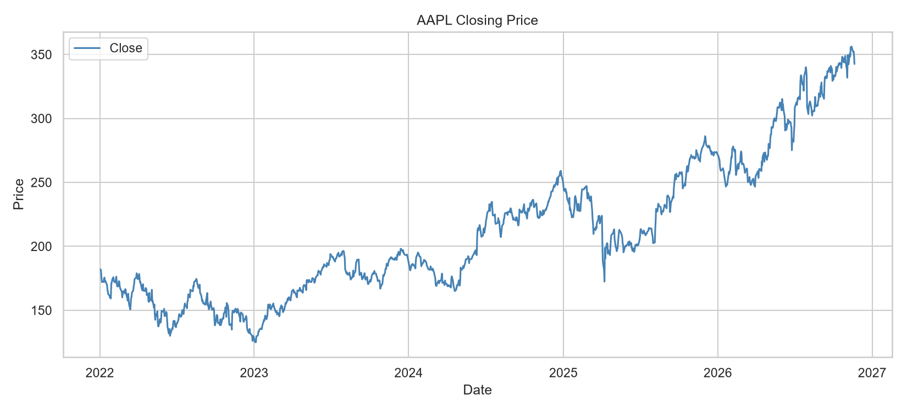
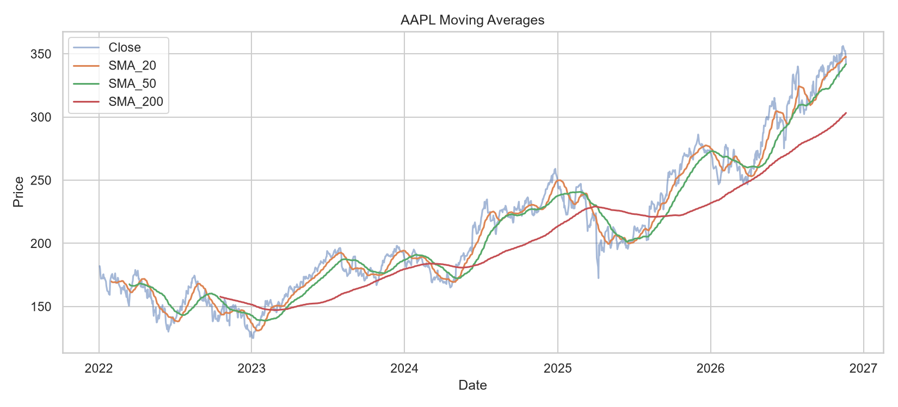
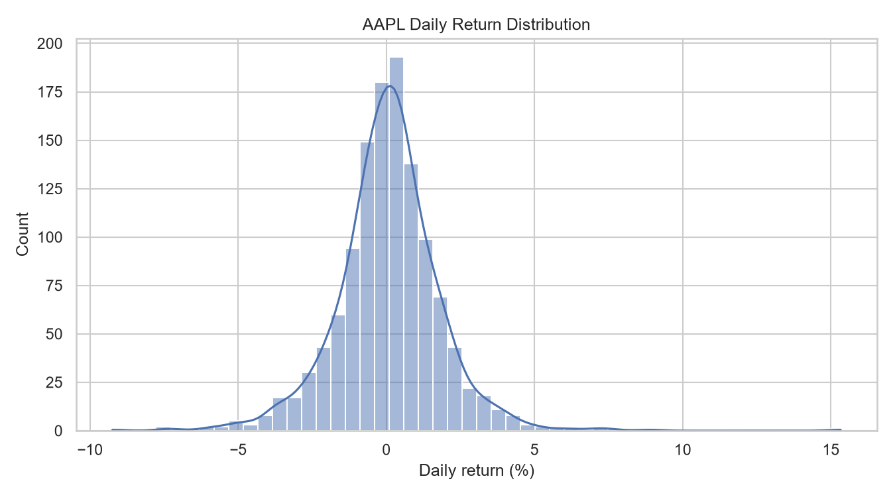
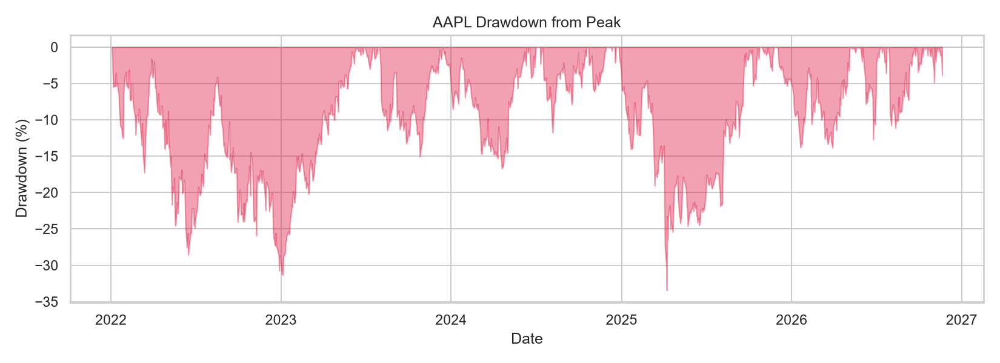

# Stock Market Data Analyzer

A Python tool that fetches historical stock data, cleans it, calculates returns, moving averages, volatility and drawdown, creates charts and writes an automatic insights report.

## Problem Statement
Manually reading raw price data is slow and error-prone. This project automates stock data analysis so trends and risk can be understood quickly.

## Industry Relevance
Brokerages, fintech apps, research teams and finance departments use the same pipeline (ingest, clean, feature engineering, risk metrics, reporting) for market tracking and decision support. Relevant for Python Developer, Data Analyst, Financial Analyst, Business Analyst and FinTech roles.

## Features
- Live data via yfinance with automatic CSV fallback
- Data cleaning (dates, duplicates, missing values)
- Daily and cumulative returns
- SMA 20/50/200 and EMA 20
- Annualized volatility, Sharpe ratio, max drawdown
- Highest/lowest price, best/worst day
- Trend detection and risk label
- 4 charts + Markdown report + processed CSV
- Optional Streamlit dashboard

## Tech Stack
Python, Pandas, NumPy, Matplotlib, Seaborn, yfinance, Streamlit

## Folder Structure
data/ notebooks/ src/ outputs/ images/ reports/ docs/ main.py app.py requirements.txt

## How to Run
```
python -m venv venv
source venv/bin/activate   # Windows: venv\Scripts\activate
pip install -r requirements.txt
python -m src.make_sample_data
python main.py --ticker AAPL --start 2022-01-01
streamlit run app.py
```

## Sample Output
See reports/AAPL_report.md and outputs/AAPL_processed.csv

## Screenshots





## Screenshots


## Learning Outcomes
Time-series handling in Pandas, API integration, modular Python design, financial metrics (returns, volatility, drawdown, Sharpe), data visualization, Git/GitHub workflow.

## Future Improvements
SQLite storage, RSI/MACD, backtesting, alerts, multi-stock comparison.

## Disclaimer
This project is for educational purposes only and is not financial advice. Past performance does not guarantee future results.

## Username: yaswitha-kamakshi
## E-mail: yaswithakamakshi.5pq@gmail.com
## LinkedIn: www.linkedin.com/in/yaswitha-kamakshi-292b5242b
